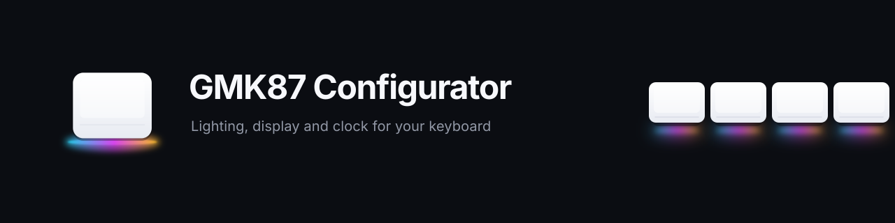
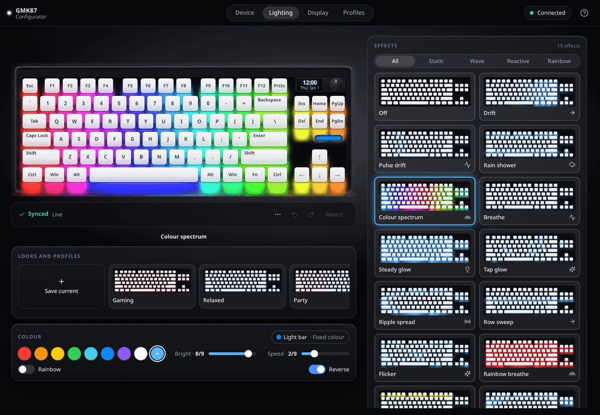
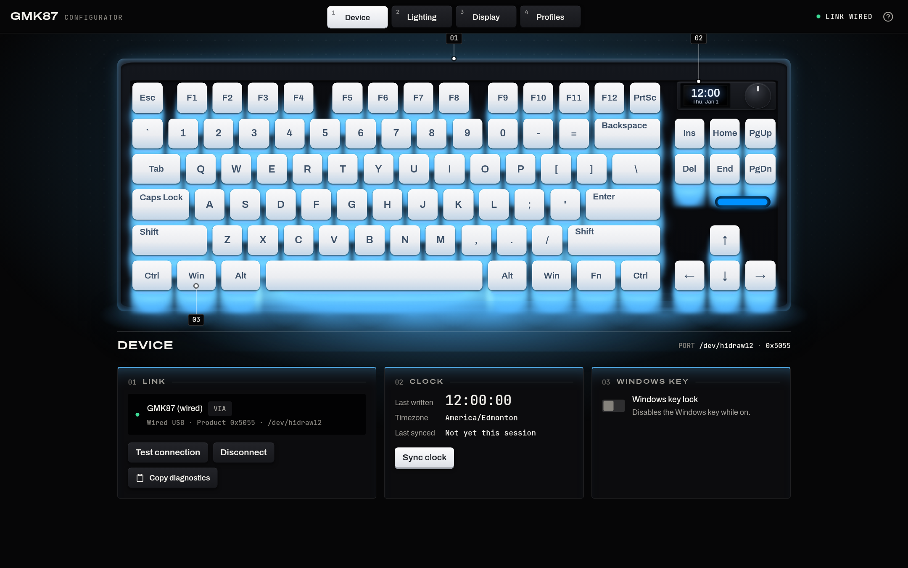
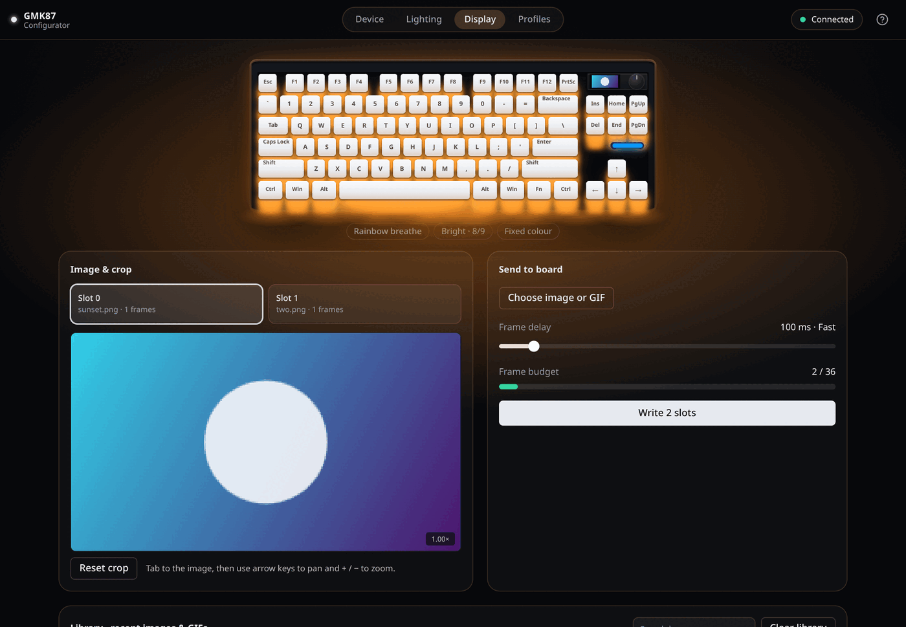
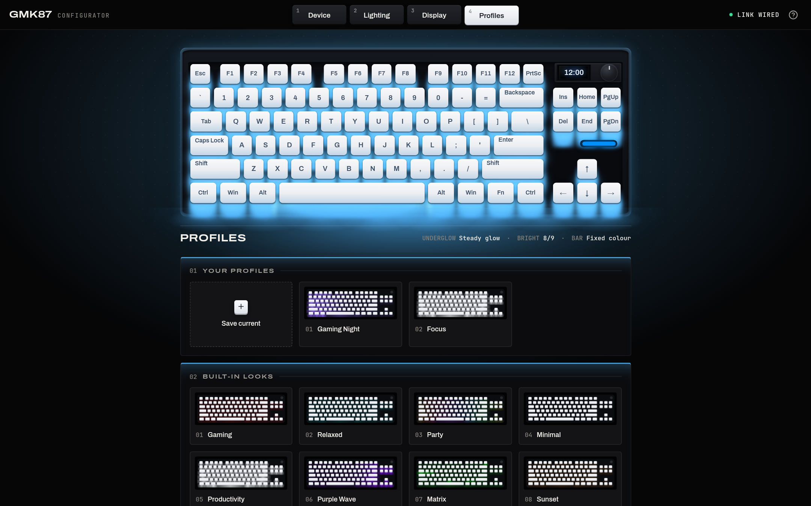

<p align="center">
  
</p>

<p align="center">
  <a href="https://github.com/misaid/gmk87-tauri-app/actions"></a>
  
  
  
</p>

**GMK87 Configurator** is an open-source desktop app and command-line tool for the
ZUOYA GMK87 mechanical keyboard. Put images and animated GIFs on its 240×135
display, control the RGB lighting, and keep its clock in sync, directly over USB
HID. It needs no vendor software, and on Linux no root once the udev rule is
installed.

<p align="center">
  
</p>

> **Hardware status.** The wired write path is verified end to end: on
> 2026-11-01 the keyboard accepted a clock write, a lighting write and a
> single-frame display upload. The 2.4 GHz upload, animation and power-cycle
> persistence are still unverified. Read
> [`docs/hardware-testing.md`](docs/hardware-testing.md) before writing to a real
> keyboard; it records what was seen and the safety rules any run must follow.

The app icon is the keycap mark from `docs/images/logo-mark.svg`; the generated
icon set lives in `ui/src-tauri/icons/`.

## Contents

- [Features](#features)
- [Screenshots](#screenshots)
- [Quick start](#quick-start)
- [Supported hardware](#supported-hardware)
- [Command-line usage](#command-line-usage)
- [Permissions: the udev rule](#permissions-the-udev-rule)
- [The write-only limitation](#the-write-only-limitation)
- [Hardware verification](#hardware-verification)
- [Architecture](#architecture)
- [Development](#development)
- [License and attribution](#license-and-attribution)

## Features

**Pair first.** The app opens on the Device page. A single keyboard connects
automatically, and the other pages unlock once it is connected.

**Lighting**
- 19 underglow effects shown as animated mini-keyboard previews, with brightness,
  speed, direction, rainbow and RGB colour.
- Side light bar: five modes, nine colours and saturation. The bar on screen
  follows the selected option.
- A per-key glow preview that mirrors the board. Choose **Auto, GPU, CPU or
  Static** under the sync menu (WebGL2 when available, adaptive frame rate).
- Changes apply live by default. Switch to **Draft** to stage edits and write them
  together. Undo, redo and revert are always available.
- Profiles: eight built-in looks plus your own saved profiles.

**Display**
- Two independent slots, each holding a static image or an animated GIF.
- Smooth crop, zoom and pan editing, with instant switching between slots.
- A frame-budget meter (36 frames across both slots) that reports when a GIF was
  compressed to fit.
- One press writes every slot you changed, with progress and cancel.
- A library remembers every image and GIF you have used so you can reuse them.
- Both slots come back after a restart with the last image and crop written to
  them.

**Clock and device**
- Syncs the keyboard clock to local time, in the device's packed-BCD format.
- Windows key lock, connection diagnostics, wired and 2.4 GHz dongle detection.

**Command line.** Everything above except the editors is available from
`gmk87-cli` for scripting and recovery.

Not in scope: keymap remapping, firmware updates, and reading the device's
current settings (the hardware cannot be read at all, see
[below](#the-write-only-limitation)).

## Screenshots

<table>
  <tr>
    <td width="50%"><br><sub><b>Device</b>: connect, sync the clock, lock the Windows key.</sub></td>
    <td width="50%"><br><sub><b>Display</b>: crop two slots and write them in one press.</sub></td>
  </tr>
  <tr>
    <td width="50%"><br><sub><b>Profiles</b>: one-click looks and your saved setups.</sub></td>
    <td width="50%"><br><sub><b>Lighting</b>: 19 effects with live previews.</sub></td>
  </tr>
</table>

## Quick start

Each tagged version publishes a Linux AppImage and a Windows installer on the
[releases page](https://github.com/misaid/gmk87-tauri-app/releases) (plus a `.deb`
that installs the udev rule, and SHA-256 checksums). The Windows installer is not
code-signed, so SmartScreen may warn on first run. On Linux with the AppImage,
install the udev rule once (see below). To build from source instead:

```bash
# Linux prerequisites (Debian/Ubuntu shown)
sudo apt install libudev-dev pkg-config libwebkit2gtk-4.1-dev libgtk-3-dev \
  libsoup-3.0-dev librsvg2-dev
# plus Rust (see rust-toolchain.toml) and bun: https://bun.sh

git clone https://github.com/misaid/gmk87-tauri-app
cd gmk87-tauri-app

# Linux only: let your user open the keyboard without root
sudo cp packaging/50-gmk87.rules /etc/udev/rules.d/
sudo udevadm control --reload-rules && sudo udevadm trigger
# unplug and replug the keyboard

cd ui && bun install
bun run tauri dev      # opens the configurator
```

On macOS and Windows the keyboard is reached through the OS HID stack, so there
is no udev rule. Only Linux has been verified against hardware.

## Supported hardware

| Device | USB ID | Notes |
|---|---|---|
| ZUOYA GMK87, wired | `320f:5055` | vendor channel on usage page `0xFF1C`, report ID `0x04` |
| ZUOYA GMK87, 2.4 GHz dongle | `320f:5088` | vendor channel on `0xFF1C`; slower acknowledgements |

Both transports are detected. With both plugged in, discovery returns two
devices: the wired keyboard first, then the dongle. The CLI opens the **first**
one, so unplug the transport you do not want to use. Only one session is open at
a time; the keyboard has a single state machine.

The keyboard also exposes a VIA raw-HID interface (`0xFF60`). It is detected and
reported (`via=true` in `probe`) but never driven.

## Command-line usage

```bash
gmk87-cli probe
gmk87-cli show-config
gmk87-cli clock
gmk87-cli lights --brightness 5
gmk87-cli lights --effect 5 --brightness 9 --speed 3 --rgb 248,255,0
gmk87-cli lights --orientation 1 --underglow-rainbow 1 --winlock true
gmk87-cli lights --led-mode 2 --led-color 5 --led-saturation 7 --led-rainbow 1
gmk87-cli upload picture.png --slot 0 --show
gmk87-cli upload animation.gif --slot 1
```

Run from the source tree with `cargo run -p gmk87-cli -- <args>` instead.

| Command | What it does |
|---|---|
| `probe` | lists detected keyboards: label, `/dev/hidraw*` path, product ID, whether VIA is present. Read-only. |
| `show-config` | prints the configuration the app would write, from the saved snapshot. Performs **no device I/O**. |
| `clock` | syncs the keyboard clock to local time. |
| `lights` | patches underglow and side-LED fields and writes the block. Options: `--effect`, `--brightness`, `--speed`, `--orientation` (0–1), `--underglow-rainbow` (0–1), `--rgb R,G,B`, `--winlock true\|false`, `--led-mode`, `--led-saturation` (0–9), `--led-rainbow` (0–1), `--led-color`. |
| `upload <file>` | uploads an image or animated GIF to `--slot 0` or `--slot 1` (default 0). `--show` switches the display to that slot; without it the upload still happens but the display is switched to the **clock**. |

Notes that surprise people:

- Every successful write sends the **whole 48-byte configuration block**,
  including fields this command does not change. There is no read-modify-write,
  because the device cannot be read.
- Every command starts from the saved snapshot
  (`$XDG_DATA_HOME/gmk87/config.snapshot`, falling back to
  `~/.local/share/gmk87/config.snapshot`) and updates it after a successful
  write. Delete that file to fall back to the reference defaults.
- Each frame is 65,536 bytes on the wire — 1,171 packets. Over the 2.4 GHz
  dongle, which acknowledges about one packet per second, an upload is very slow
  and bounded by a 300 s ceiling. Prefer the wired transport.

## Permissions: the udev rule

Without a rule, opening `/dev/hidraw*` needs root. `packaging/50-gmk87.rules`
grants the active seat access via `TAG+="uaccess"`:

```bash
sudo cp packaging/50-gmk87.rules /etc/udev/rules.d/
sudo udevadm control --reload-rules
sudo udevadm trigger
# unplug and replug the keyboard
gmk87-cli probe
```

One-liner for AppImage users, straight from the repository:

```bash
curl -fsSL https://raw.githubusercontent.com/misaid/gmk87-tauri-app/main/packaging/50-gmk87.rules | sudo tee /etc/udev/rules.d/50-gmk87.rules >/dev/null && sudo udevadm control --reload-rules && sudo udevadm trigger
```

The `.deb` package installs the rule to `/usr/lib/udev/rules.d/` itself. Do not run the CLI with
`sudo`: the rule already gives the logged-in user access, and root-run commands
would leave a root-owned snapshot in `~/.local/share/gmk87/` that later
unprivileged runs could not update.

If `probe` or any write reports `PermissionDenied`, the rule is missing or the
session is not on the seat that owns the device.

## The write-only limitation

The GMK87 cannot be read. `READ_CFG (0x05)` merely echoes the request payload;
the reference "read mode" preamble resets and re-enumerates the keyboard. This
was verified on both transports and matches a capture of the official
application, which also never reads — it keeps state in its UI.

So this project owns the configuration: it keeps the 48-byte block in memory,
seeds it from the snapshot it last wrote, and writes the complete block each
time. The first write replaces anything configured with the official
application. `docs/protocol.md` §6 has the full evidence and consequences.

## Hardware verification

The wired transport is verified end to end: clock, lighting, and a single-frame
display upload. The 2.4 GHz dongle upload, multi-frame/GIF animation, the wired
acknowledgement's payload shape, and `show_image` across a power cycle remain
unverified. See [`docs/hardware-testing.md`](docs/hardware-testing.md) for the
results, the incident that shapes the safety rules (a detached upload produced
spurious keystrokes and triggered system poweroffs), and the empty rows left for
a future run.

## Architecture

```text
crates/
  gmk87-protocol/   pure, no I/O: packet codec, checksum, 48-byte configuration
                    block, RGB565 conversion, image crop/scale, GIF frames and
                    the upload frame budget
  gmk87-device/     discovery, the hidapi Transport, and the Session state
                    machine: configuration writes, upload streaming, repair
  gmk87-app/        Tauri-independent orchestration: session ownership, the
                    both-slot image memory, upload jobs, lighting presets and
                    on-disk snapshots, tested against a mock transport
  gmk87-cli/        the gmk87-cli debug and recovery tool
ui/                 React + TypeScript + Vite front end (Tailwind, shadcn/ui
                    style components, canvas and WebGL2 keyboard preview)
ui/src-tauri/       Tauri v2 command and event adapter over gmk87-app
docs/
  protocol.md               corrected protocol reference
  hardware-testing.md       verified results, safety rules, results table
packaging/
  50-gmk87.rules            udev rule granting seat access without root
```

The protocol crate is deliberately free of I/O so a future background service
can link it unchanged; `gmk87-app` is deliberately free of Tauri so the whole
application layer is unit-testable without a window.

Every upload streams **both** display slots, because the keyboard rewrites all of
its image memory in one session. The slot you did not change is resent from the
app's copy of what it last uploaded, rebuilt from disk when the app connects, so
it is preserved across restarts. Each slot's name, crop and source bytes are
stored under the app data directory; a source over 25 MB keeps its metadata but
not its bytes, so that slot cannot be restored.

Connection monitoring is platform-aware. A healthy session is watched by
re-enumerating HID devices rather than by testing the device path as a file:
Windows reports paths such as `\\?\hid#vid_320f…` that `stat` can never resolve.
A probe that cannot answer is treated as *inconclusive*, two consecutive misses
are required before a session is dropped, and each connect carries a generation
counter so a stale watchdog cannot tear down a newer session.

## Development

```bash
cargo build --release                       # target/release/gmk87-cli
cargo test --all                            # mock transports only; never touches a keyboard
cargo fmt --all --check
cargo clippy --all-targets -- -D warnings

cd ui/src-tauri && cargo test && cargo clippy --all-targets -- -D warnings
cd ui && bun run test && bun run build      # front end tests and production build
```

`hidapi` needs `libudev-dev` and `pkg-config` on Debian/Ubuntu,
`systemd-devel` on Fedora and `systemd-libs` on Arch. The release workflow
builds the Linux AppImage and the Windows NSIS installer on version tags.

## License and attribution

GPL-3.0-or-later; see `LICENSE`.

The USB protocol was documented by the community and this project ports the
packet format and command sequence from MIT-licensed work
(`codedgar/gmk87-node`, `ikkentim/gmk87-usb-reverse`). Attribution is recorded in
`NOTICE` and in [`docs/protocol.md`](docs/protocol.md) §1.
